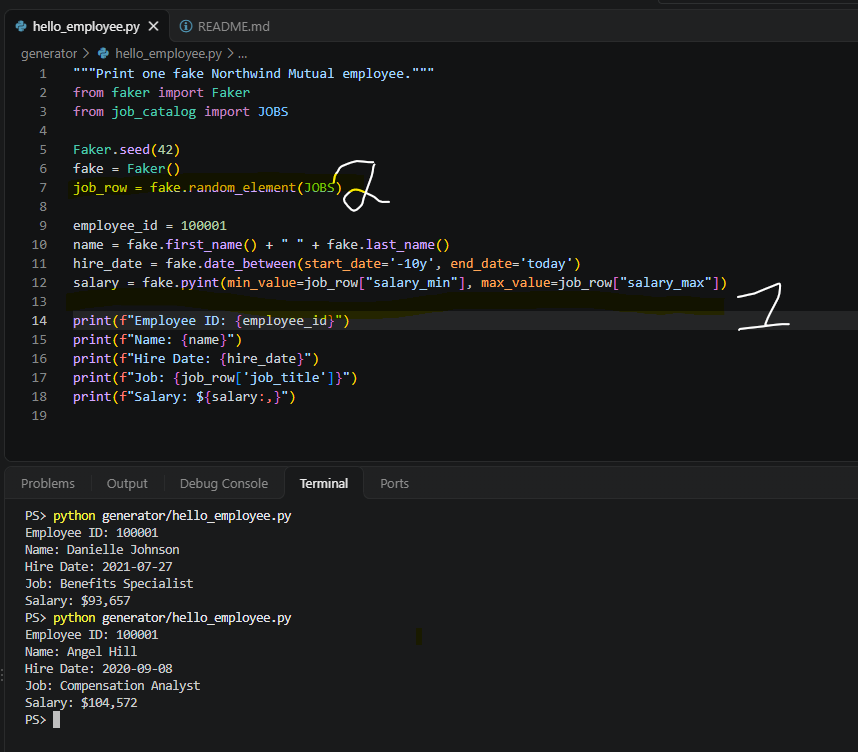

# Day 002: A job catalog, and why the order of the steps matters

*Draft by Claude. Thomas edits before posting.*

## Portfolio post

**What I worked on**

Yesterday my fake employee was always a Compensation Analyst making $120,000. That isn't how pay works. Every job sits in a grade, and every grade has a pay range. Today's ask, written like a Total Rewards manager would write it: give the generator a small job catalog, and have each employee pick a real job and get a salary inside that job's range.

**What I learned**

A Python **list of dicts** is just a table. Each dict is one row, and its keys are the column names. If you've used Power Query, a dict is a record, and a list of dicts is a table built from records.

```python
JOBS = [
    {"job_code": 1, "job_title": "Compensation Analyst", "grade": 4, "salary_min": 100000, "salary_max": 125000},
    {"job_code": 3, "job_title": "Payroll Coordinator", "grade": 1, "salary_min": 75000, "salary_max": 90000},
    # ...three more jobs
]

job_row = fake.random_element(JOBS)
salary = fake.pyint(min_value=job_row["salary_min"], max_value=job_row["salary_max"])
```

Two things stuck with me:
- Python counts from **0**. `JOBS[4]` is the fifth job.
- With a fixed seed, every random call takes the next number in a fixed sequence. Move one line and every value after it changes. The output stays repeatable, but only if the order stays the same.

I tested that myself. First run: I put the job pick at spot 1, after the name and hire date. Second run: I moved it up to spot 2, before them. Same seed, same code, different employee, because the job pick took a different number in the sequence.



**What was hard**

My first catalog had a grade 1 job paying more than a grade 2 job. In a real pay structure, a higher grade means a higher range, and a compa-ratio report would flag that right away. I swapped the grades. I also had two different jobs with the same title for a while, which would have blended them together in any report grouped by title.

The mechanics tripped me up too. I created two typo branches by re-running `git switch -c` (create) when I meant `git switch` (go to). I saved a file with a misspelled name, and then saved it empty. I renamed a variable in one place and not the other three, and the linter caught it before I could ship it. The pace also got ahead of me early on. Claude reset to one step at a time: first fill in the table in plain words, then turn one row into Python. That worked much better.

**Shipped:** [PR #5](https://github.com/analysttom712/total-rewards-analytics/pull/5)

**Tomorrow:** turning "make one employee" into a function, and looping it to make many.

---

## LinkedIn version

Day 2: a pay range is just a small table, and Python can hold one.

Yesterday my fake employee always had the same job and salary. Today I gave the generator a 5-job catalog, each job with a grade and a pay range. Now each employee picks a job and gets a salary inside that job's range.

What I learned:
- A Python list of dicts is a table. Each dict is a row, like a record in Power Query.
- Python counts from 0, so the fifth job is JOBS[4].
- With a fixed seed, the order of the random calls matters. I tested it: I moved one line and got a completely different employee, with the same seed and the same code (screenshot).

What I got wrong: I gave a grade 1 job a higher range than a grade 2 job. A compa-ratio report would have flagged it right away. I also made two typo branches in Git and renamed a variable in only one of four places. The linter caught that one before it shipped.

All synthetic data, for a fictional company.

Following along here: https://analysttom712.github.io/projects/total-rewards-platform.html

#AnalyticsEngineering #TotalRewards #Python #LearningInPublic
