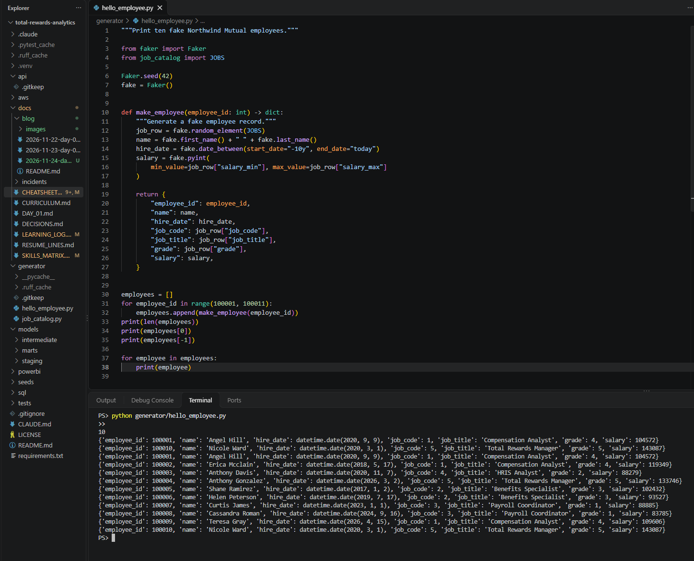
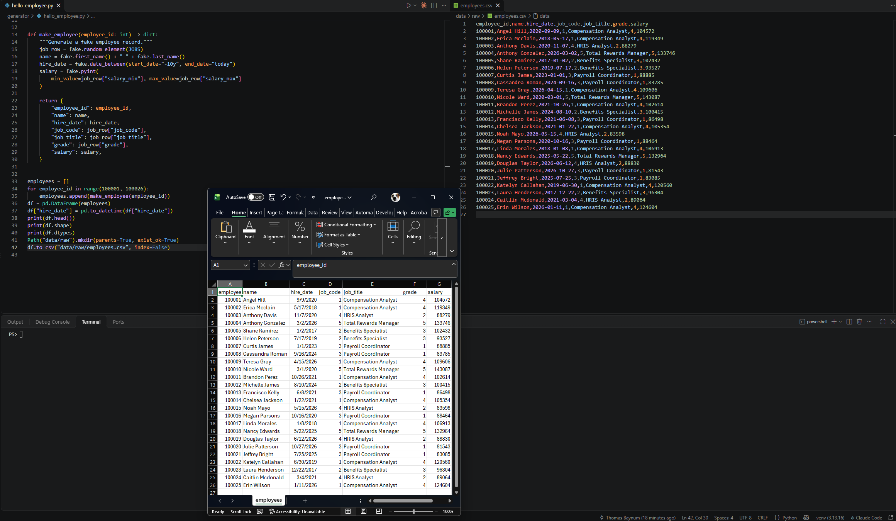

# Day 003: From one employee to a workforce, and slowing down to make it stick

*Draft by Claude. Thomas edits before posting.*

## Portfolio post

**What I worked on**

A Total Rewards team doesn't analyze one employee. It analyzes a workforce. Today had three parts:

1. Turn my fake-employee script into a function and generate any number of employees with unique IDs.
2. Put those employees into a pandas DataFrame and write them to a CSV file.
3. Stop before the next ticket (my first automated tests) and do a deep review of everything from Days 1–3, because I didn't feel ready yet.

**Part 1: functions and loops**

A **function** is a recipe you write once and run as many times as you need. If you've built a custom function in Power Query and invoked it on every row, it's the same idea.

```python
def make_employee(employee_id: int) -> dict:
    """Generate a fake employee record."""
    job_row = fake.random_element(JOBS)
    ...
    return {
        "employee_id": employee_id,
        "job_title": job_row["job_title"],
        "grade": job_row["grade"],
        "salary": salary,
        # ...plus name, hire date and job code
    }


employees = []
for employee_id in range(100001, 100026):
    employees.append(make_employee(employee_id))
```

Things that stuck:
- `employee_id: int` describes what goes **in**, and `-> dict` describes what comes **out**.
- Python needs an explicit `return`. R hands back the last line automatically, so this one caught me.
- `range(100001, 100026)` stops *before* the second number. Stop minus start tells you how many you get: 25.



**Part 2: a DataFrame and a CSV**

A pandas DataFrame is a table in Python: each dict becomes a row, each key becomes a column. The steps map almost one-to-one onto Power Query:

| pandas | Power Query |
|---|---|
| `pd.DataFrame(employees)` | Table from records |
| `df.dtypes` | The ABC / 123 icons on column headers |
| `pd.to_datetime(df["hire_date"])` | "Changed Type" → Date |
| `df.to_csv(..., index=False)` | Export, without the row-number column |



**Part 3: the deep review**

Instead of starting tests, I spent a session re-doing the basics with predictions: guess the output, then run it.

- **Git:** I staged, unstaged and committed real files to see each of Git's four states (untracked, modified, staged, committed) in `git status`, then pushed, opened a pull request and merged it myself.
- **Lists vs dicts:** `jobs[1]["job_title"]` means row first (a position), then column (a name). I predicted which error each bad lookup throws: `IndexError` for a missing position, `KeyError` for a missing name, `TypeError` for asking a list for a name.
- **`print` vs `return`:** `print` is like a card visual: you see the number, but nothing can use it. `return` is like a measure: other code can build on it.

**What was hard**

Naming, again. In Part 1 I used `employee` for the list, the loop's ID and a single row, and Python couldn't tell them apart. Three things need three names: `employees`, `employee_id` and `make_employee(...)`.

In the review, I typed practice code into my real script instead of a scratch spot, and VS Code's AI autocomplete kept filling in code I hadn't thought through. Git showed exactly what had changed, and one `git restore` put the file back. I've turned autocomplete off for practice.

I also double-counted: `annual_premium(monthly * 12)` annualized a number that was already annual, so the result was 12 times too big. In payroll that's a real-world mistake, and it's exactly what tests are for.

My quiz scores were 2.5/5 and then 3.5/5. The concepts I'd missed most (`range`, `Closes #N`, data types) all came back right in the review. Claude ran the quizzes and kept a spaced-review list of what I miss, which is now part of how every session starts.

**Shipped:** [PR #10](https://github.com/analysttom712/total-rewards-analytics/pull/10) (functions and loops), [PR #11](https://github.com/analysttom712/total-rewards-analytics/pull/11) (DataFrame → CSV), [PR #15](https://github.com/analysttom712/total-rewards-analytics/pull/15) (my learning workflow).

**Next:** my first pytest tests, starting with "the same seed gives the same employees".

---

## LinkedIn version

Day 3: one employee isn't a workforce.

Today I turned my fake-employee script into a function, looped it to build 25 employees, loaded them into a pandas DataFrame and wrote them to a CSV.

Then, before starting automated tests, I stopped and did a deep review of everything so far, predicting each output before running it.

What I learned:
- A Python function is like a Power Query custom function: write the recipe once, run it on every row.
- pandas maps onto Power Query: dtypes are the column-type icons, to_datetime is "Changed Type".
- print vs return is a card visual vs a measure. You can see a card, but only a measure can be reused.

What I got wrong: I typed practice code into my real script, and AI autocomplete filled in code I hadn't reasoned through. Git showed exactly what changed, and one command put it back. I also annualized a premium twice. That's exactly what my next ticket, tests, is for.

All synthetic data, for a fictional company.

Following along here: https://analysttom712.github.io/projects/total-rewards-platform.html

#AnalyticsEngineering #TotalRewards #Python #LearningInPublic
